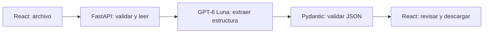

# Extractor de cuestionarios

Aplicación React + TypeScript y FastAPI que convierte PDF, DOCX y XLSX en un cuestionario
JSON. Detecta idioma, cinco tipos de ítem, alternativas y claves explícitas.

**Demo pública:** https://questionnaire-extractor-one.vercel.app

**API:** https://questionnaire-extractor-one.vercel.app/docs

**Repositorio:** https://github.com/camilosolanoa/questionnaire-extractor

**Guía para la entrevista:** [presentation.md](presentation.md)

## Ejecutar localmente

Requiere Python 3.11+ (probado con 3.13), Node 22.12+ y [uv](https://docs.astral.sh/uv/).

```powershell
uv sync
Copy-Item .env.example .env
# Edita .env y configura OPENAI_API_KEY.
npm ci --prefix frontend
npm run build --prefix frontend
uv run uvicorn backend.main:app --host 127.0.0.1 --port 8002
```

En macOS/Linux, usa `cp .env.example .env`. Abre http://127.0.0.1:8002.
Para desarrollar el frontend, ejecuta también `npm run dev --prefix frontend`;
Vite redirige `/api` y `/examples` al backend en el puerto 8002.

| Variable | Uso |
| --- | --- |
| `OPENAI_API_KEY` | Obligatoria para la extracción real; solo en el servidor. |
| `OPENAI_MODEL` | Modelo; por defecto `gpt-6-luna`. |

**Costo:** se usa GPT-6 Luna, una API de pago, por decisión del candidato. Es una
desviación explícita del requisito de free tier de la prueba. No se presenta como servicio
gratuito. Con tarifa estándar de US$0.10/M tokens de entrada y US$0.50/M de salida,
10.000 tokens de entrada + 5.000 de salida cuestan aproximadamente US$0.0035.
La aplicación realiza una llamada por extracción, sin reintentos automáticos y sin razonamiento
adicional. [Tarifas del modelo](https://developers.openai.com/api/docs/models/gpt-6-luna).

## Cómo funciona



1. FastAPI verifica tamaño, extensión y contenido; no confía en el MIME declarado.
2. `pypdf`, `python-docx` y `openpyxl` extraen texto conservando orden, filas y hojas.
3. Luna interpreta el contenido con Structured Outputs y un prompt versionado en Git.
   La clasificación semántica no depende de palabras clave ni expresiones regulares.
4. Pydantic verifica estructura, conteos, números únicos, alternativas y referencias de claves.
5. Una sola pantalla permite subir el archivo, ver el JSON y descargarlo. No hay cuentas ni base de datos.

El frontend tiene un componente, cuatro estados (archivo, procesamiento, error y resultado),
una petición POST y estilos CSS simples. No usa pestañas, bibliotecas de UI ni estado global.
Las dependencias de Python se definen en `pyproject.toml` y se fijan en `uv.lock`.

Lectura del código: `backend/files.py` → `backend/prompt.txt` → `backend/llm.py` →
`backend/models.py` → `backend/main.py` → `frontend/src/main.tsx`.

## Contrato y supuestos

`POST /api/extract` recibe `multipart/form-data` con el campo `file` y devuelve los campos
`titulo`, `idioma`, `total_items`, `items`; cada ítem contiene `numero`, `enunciado`, `tipo`,
`alternativas` y `respuesta_correcta`. El esquema completo se publica en `/docs`.

- Se conserva el idioma y texto originales; se normaliza el espacio en blanco.
- Se incluye una respuesta correcta **solo si está indicada**. No se resuelven preguntas.
  Un valor de puntuación Likert no equivale a una respuesta correcta.
- Una escala compartida se aplica únicamente a su sección. Si faltan valores explícitos,
  se usan 0, 1, 2… en escalas y A, B, C… en otras alternativas.
- Se conservan números de ítem únicos y positivos. Si faltan o se repiten entre secciones,
  se asignan números consecutivos en orden de aparición. Si no hay título: `Sin título`.
- En verdadero/falso sin opciones impresas, una instrucción explícita V/F permite crear
  las dos etiquetas en el idioma original. Desarrollo usa `[]` y respuesta `null`.
- **Emparejamiento:** un ítem por ejercicio; alternativas de izquierda y derecha con valores
  `L1`, `L2`, `RA`, `RB` (prefijos L/R sobre las etiquetas originales). Una clave explícita
  se representa como `L1=RB;L2=RA`; si no aparece, es `null`. Esta convención resuelve una
  ambigüedad del esquema del enunciado sin agregar campos a la respuesta pública.
- El proveedor devuelve internamente un estado para distinguir falta de ítems de exceso
  de ítems. La API pública devuelve únicamente el cuestionario válido.

## Límites y errores

- Archivo: 3 MB; texto: 60.000 caracteres; cuestionario: 100 ítems.
- PDF: hasta 20 páginas con texto. PDF escaneados, páginas sin texto y documentos
  protegidos se rechazan; **no se implementó OCR**. Diagramas, imágenes y diseños complejos
  pueden requerir revisión manual. Word procesa párrafos y tablas del cuerpo, no notas ni encabezados.
- Excel: hasta 10 hojas, 2.000 filas y 50 columnas por hoja. Se rechazan fórmulas;
  se deben exportar sus valores. No se siguen enlaces externos.
- Contenedores Office: máximo 2.000 entradas y 20 MB descomprimidos.
- 415: formato inválido; 413: tamaño/límites; 422: archivo ilegible, sin texto o sin ítems;
  429: demasiados intentos; 502/503/504: salida inválida, proveedor no disponible o timeout.
- El límite de 10 intentos/minuto por dirección de conexión es local al proceso y de mejor
  esfuerzo. En Vercel puede reiniciarse o repartirse entre instancias; **no es un límite global
  de gasto**. Un servicio de uso masivo necesitaría cuotas persistentes o un gateway.
- La entrada está separada de las instrucciones del sistema. No se habilitan herramientas
  al modelo. Esto reduce el riesgo de instrucciones maliciosas dentro de documentos, pero
  no garantiza exactitud semántica: siempre se debe revisar el resultado antes de usarlo.

No se persisten archivos ni resultados: se cierra el archivo temporal al terminar. El texto
se envía a OpenAI con `store=False`; esto no equivale a una promesa de retención cero por
el proveedor. No se registran documentos, claves ni respuestas en logs. Solo se deben subir
cuestionarios inventados o de dominio público, sin tests comerciales ni datos personales.

## Ejemplos y comprobaciones

`examples/` contiene material completamente inventado:

| Archivo | Idioma | Contenido |
| --- | --- | --- |
| `cuestionario-es.pdf` | Español | 6 ítems y los 5 tipos |
| `questionario-it.docx` | Italiano | Párrafos y tablas; 6 ítems |
| `questionnaire-en.xlsx` | Inglés | Preguntas y clave en hojas separadas; 6 ítems |

Cada ejemplo incluye `.txt` (fuente legible), `.expected.json` (respuesta definida al diseñar
el ejemplo) y `.result.json` (resultado real del modelo). Los tres resultados coincidieron
exactamente con sus expectativas. La pregunta verdadero/falso, aunque es resoluble, queda
sin clave porque el documento no la indica. También se probaron con el modelo real un texto
sin preguntas (422) y un cuestionario de 101 preguntas (413).

```powershell
uv run pytest -q
uv run ruff check .
uv run ruff format --check .
npm run build --prefix frontend
# Evaluación real opcional: requiere la clave y consume tokens.
uv run python -m scripts.evaluate
```

33 pruebas automatizadas, sin llamadas de pago: validación de archivos, tablas, hojas,
PDF sin texto, expansión ZIP, esquema, claves, errores del proveedor y API. GitHub Actions
ejecuta las pruebas y el build sin necesitar una clave. No sustituyen la evaluación semántica.

Prueba de navegador reproducible con la app local activa (consume una llamada):

```powershell
New-Item -ItemType Directory -Force output
npx --yes --package @playwright/cli playwright-cli open http://127.0.0.1:8002
npx --yes --package @playwright/cli playwright-cli run-code --filename scripts/browser-check.js
```

Comprueba subida real, JSON, descarga, diseño móvil y formato inválido.

## Deploy y mejoras

Vercel ejecuta FastAPI y sirve el build de React desde el mismo dominio. Configura
`OPENAI_API_KEY` como variable **sensible de producción** y ejecuta `vercel deploy --prod`.
`vercel.json` define el build y un máximo de 120 segundos; la llamada al proveedor tiene
timeout de 65 segundos. Los secretos y archivos locales están excluidos de Git.
El deploy actual se realizó por CLI; publicar commits en GitHub no implica un nuevo deploy.

Con más tiempo: evaluación con más formatos reales de dominio público, OCR, revisión/edición
humana, paginación por bloques para documentos largos y cuotas globales persistentes.

IA asistió con implementación, pruebas, ejemplos y documentación. Las limitaciones y la
desviación de costo se describen para permitir una revisión transparente.
